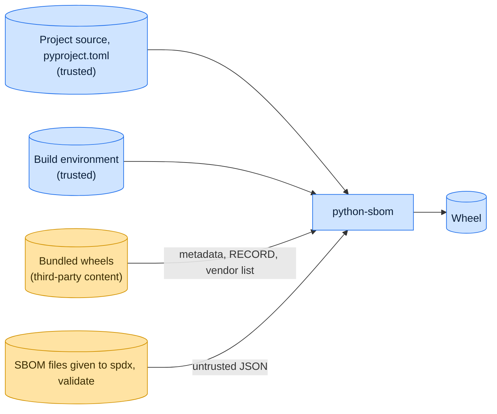

# Threat model

This model says what python-sbom trusts, where untrusted input enters, and which guarantees hold at each boundary, so a
report can be classified as a vulnerability or a bug. [SECURITY.md](SECURITY.md) covers reporting; if the two disagree,
SECURITY.md wins and we fix this file.

## How python-sbom works

The build hook runs inside a hatchling wheel build. It reads the wheel's core metadata, the project's license files, the
wheels the project bundles and the installed distributions of the build environment, and writes a CycloneDX document
that it writes into the built wheel. `python-sbom embed` does the same for a wheel another backend built,
`python-sbom archive` describes another zip archive such as a zipapp, and `python-sbom spdx` and `validate` read
CycloneDX documents and write or check them.

## Trusted

An attacker who controls any of these already has what python-sbom could give them:

- The project source, its `pyproject.toml`, the build hook script, and the module the `content-provider` option or
  `--content-provider` names: python-sbom imports that module from the project directory, so `embed` and `archive` run
  code from `--root`.
- The git checkout that tracks the project, whose `HEAD` python-sbom reads. A repository that merely contains the
  project directory is not trusted: git is used only when it tracks the project, and runs with `core.fsmonitor` off.
- The build environment and the build backend.
- The wheel handed to `python-sbom embed` and the archive handed to `python-sbom archive`, which the project's own build
  produced.

## Untrusted inputs

| Input                                   | Comes from                | What python-sbom guarantees                                                                                                                                   |
| --------------------------------------- | ------------------------- | ------------------------------------------------------------------------------------------------------------------------------------------------------------- |
| Metadata and `RECORD` of bundled wheels | Upstream projects         | Read as text with capped sizes, copied as JSON strings; every member is checked against its `RECORD` row, duplicate members are refused, nothing is executed. |
| `_vendor/vendor.txt` of bundled wheels  | Upstream projects         | Each line must pin one exact version, or the build fails.                                                                                                     |
| SBOM files given to `spdx`, `validate`  | Whoever produced the file | Parsed as JSON only, with capped sizes and nesting; problems are reported, not raised; `spdx` writes the one file named on the command line.                  |

## Threats and controls

| STRIDE                 | Threat                                                     | Control                                                       |
| ---------------------- | ---------------------------------------------------------- | ------------------------------------------------------------- |
| Tampering              | A bundled wheel's metadata injects JSON into the document. | The document is serialized with `json.dumps`.                 |
| Tampering              | A bundled wheel changes and the SBOM still lists it.       | Each bundled wheel is hashed from its bytes at build time.    |
| Elevation of privilege | A bundled wheel runs code during the build.                | Wheels are read as zip archives; nothing in them is imported. |

## Release chain

Releases run on the shared [tox-dev/github-workflows](https://github.com/tox-dev/github-workflows) pipeline. A release
App, not a person, pushes the release commit and tag; the build installs its tools from a hash-checked `pylock.toml`
resolved with a seven-day upload cooldown by default; PyPI receives the files through
[trusted publishing](https://docs.pypi.org/trusted-publishers/) with attestations, and the GitHub Release is immutable.
Every workflow pins third-party actions to a commit SHA.

## Severity

- **High:** a bundled wheel or SBOM file that makes python-sbom run code or write outside its output.
- **Medium:** an SBOM that misstates a hash, a license or the contents of a wheel.
- **Low:** a crash on a malformed bundled wheel or SBOM file instead of a clean error.

## Accepted risks

- The SBOM reports what the build environment holds; it does not check that environment against a lock.

## Keeping this current

Revisit this model when python-sbom gains a new input, a new way to run code, or a new place it writes to, and whenever
an advisory is published.
